  <a href="https://raymondreamer.com">website</a> ·
  <a href="https://youtube.com/@realitydesigners">youtube</a> ·
  <a href="https://twitter.com/raymondreaming">twitter</a> ·
  <a href="https://instagram.com/raymondreamer">instagram</a> ·
  <a href="https://github.com/raymondreaming/scripts">scripts</a> ·
  <a href="https://github.com/raymondreaming/zed-theme">zed-theme</a>

